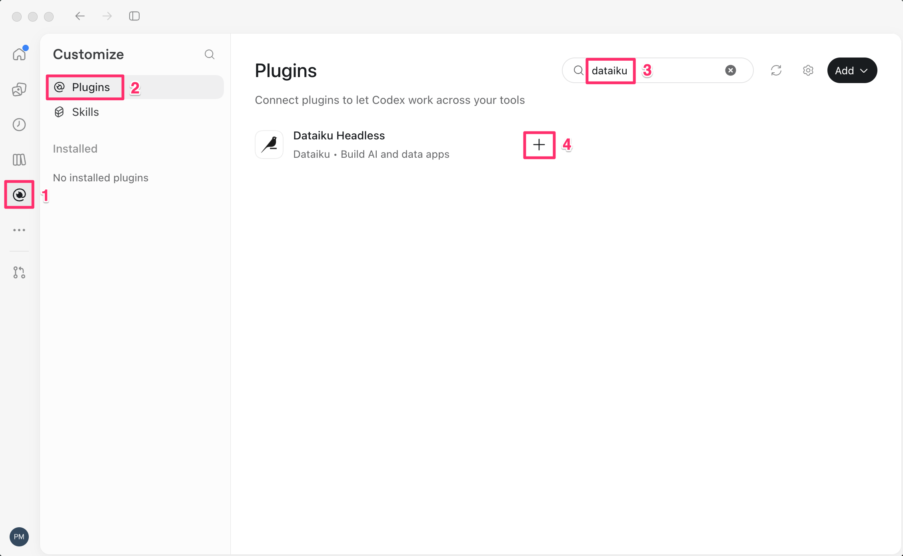
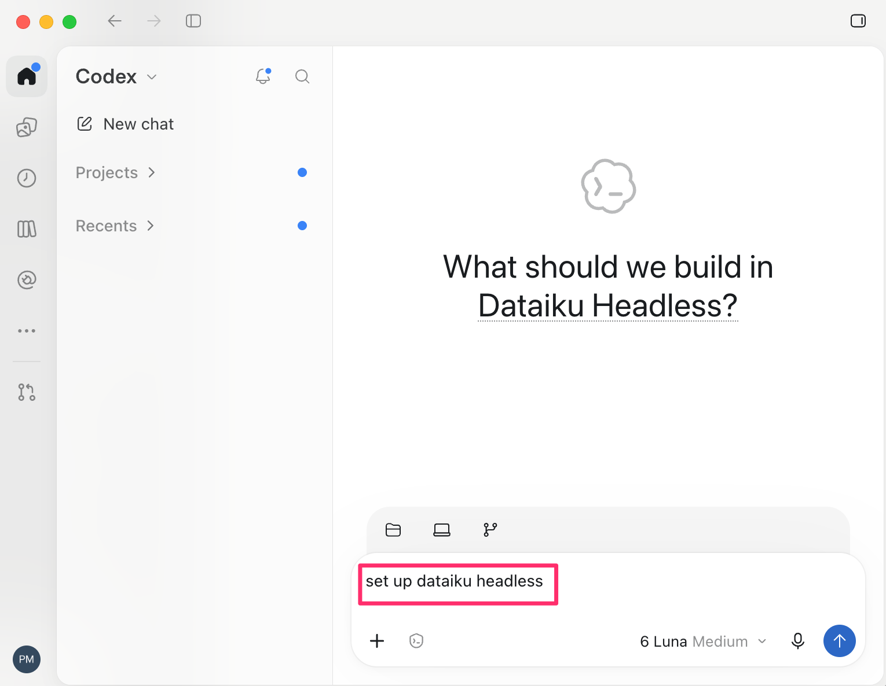

# ChatGPT desktop app

This guide covers installing and connecting Dataiku Headless in the ChatGPT
desktop app, in either Codex or Work mode.

## Before you start

Have your Dataiku instance URL and personal API key ready. Do not paste the key
into the conversation. Dataiku Headless also needs network access to the instance
and [uv 0.12.0 or later](https://docs.astral.sh/uv/getting-started/installation/).
The setup flow checks for uv and, with your approval, can install it.

## Install

Choose a mode:

- **Codex:** choose **Codex** from the selector at the top left and use the
  **This computer** environment.
- **Work:** choose **ChatGPT** from the selector, then **Work** in the
  **Chat / Work** switch at the top of the window.

Open **Plugins → Public**, search for **Dataiku**, and click **+** to install
Dataiku Headless.

## Connect to Dataiku

In your chosen mode, start a chat and ask **Set up Dataiku Headless**. The
screenshot shows the prompt in Codex; the same request works in Work.

Approve the MCP server URL prompt if the app asks. In the setup page, add an instance
with a name, instance type, Dataiku URL, and personal API key. Select the type that
matches your node (Design, Automation, or Deployer). Find your key in Dataiku under
Profile & Settings → API keys. Keep the key in the setup page; do not paste it into
chat. Test the connection, save the instance, and select **Done**. The profile stores
credentials locally in plaintext with user-only file permissions. The checkboxes to use
the instance by default and switch to it after saving are selected by default.

Ask the agent to verify the connection or show the projects you can access.
Building or changing project logic requires a Design node with Cobuild available.

For multiple instances, certificate trust, or environment configuration, see
[Connecting to Dataiku](../connecting-to-dataiku.md).

[Back to the README](../../README.md)
