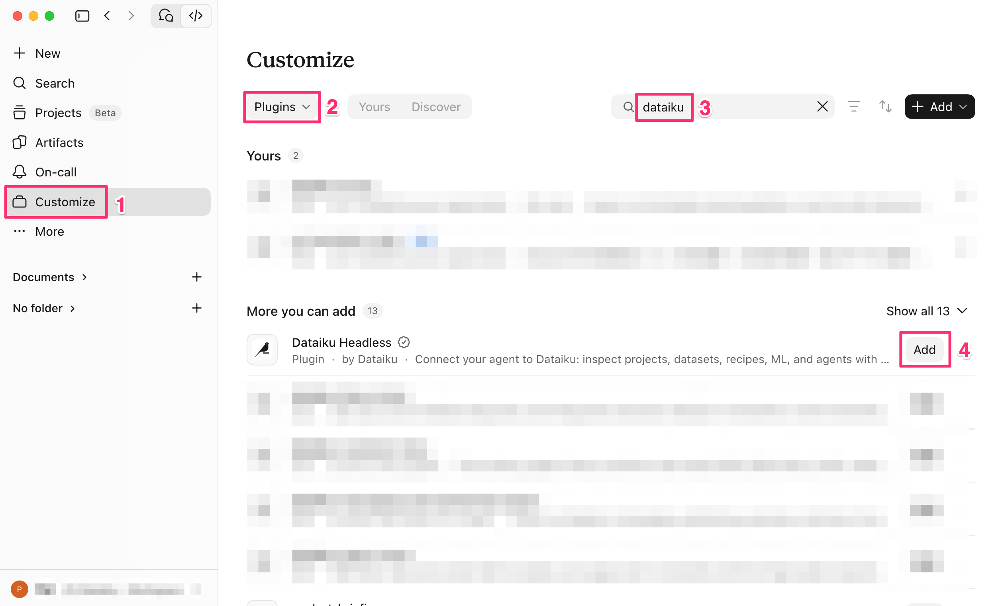
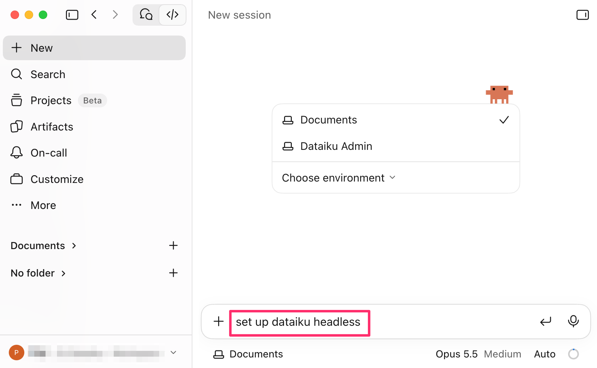

# Claude desktop app (Cowork or Claude Code)

This guide covers installing and connecting Dataiku Headless in Claude Cowork or
Claude Code in the Claude desktop app.

## Before you start

Have your Dataiku instance URL and personal API key ready. Do not paste the key
into the conversation. Dataiku Headless also needs network access to the instance
and [uv 0.12.0 or later](https://docs.astral.sh/uv/getting-started/installation/).
The setup flow checks for uv and, with your approval, can install it.

## Install

Choose a mode:

- **Cowork:** select the conversation icon at the top left, then **Cowork** in
  the **Chat / Cowork** switch in the message box.
- **Claude Code:** select the **code icon (`</>`)** at the top left and choose a
  local working environment.

Open **Customize → Plugins → Discover**, search for **Dataiku**, select
Dataiku Headless, and click **Add**.

## Connect to Dataiku

In Cowork or Claude Code, start a chat and ask **Set up Dataiku Headless**.

Approve the MCP server URL prompt if Claude asks. In the setup page, add an instance
with a name, instance type, Dataiku URL, and personal API key. Select the type that
matches your node (Design, Automation, or Deployer). Find your key in Dataiku under
Profile & Settings → API keys. Keep the key in the setup page; do not paste it into
chat. Test the connection, save the instance, and select **Done**. The profile stores
credentials locally in plaintext with user-only file permissions. The checkboxes to use
the instance by default and switch to it after saving are selected by default.

Ask Claude to verify the connection or show the projects you can access.
Building or changing project logic requires a Design node with Cobuild available.

For multiple instances, certificate trust, or environment configuration, see
[Connecting to Dataiku](../connecting-to-dataiku.md).

[Back to the README](../../README.md)
